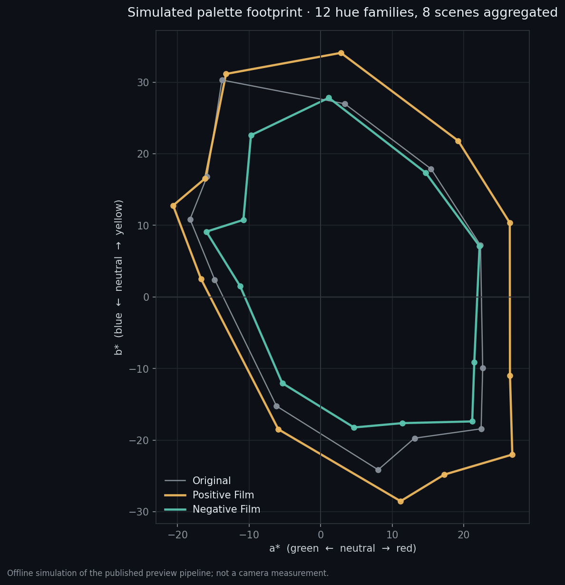
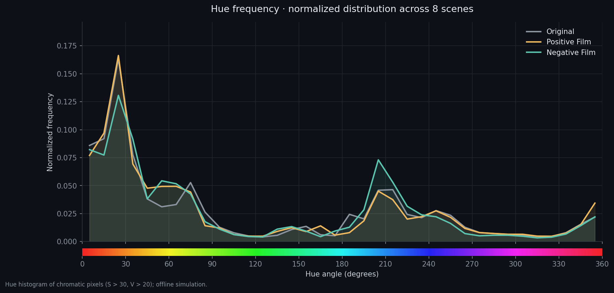
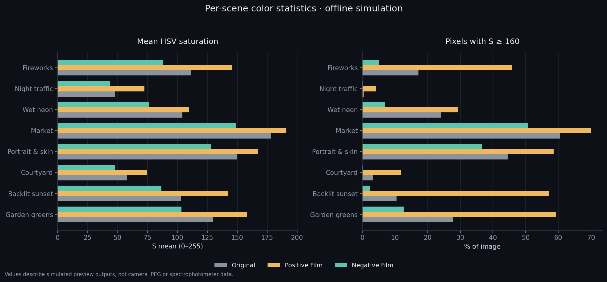
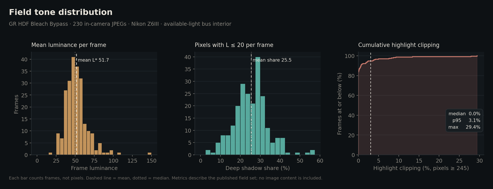
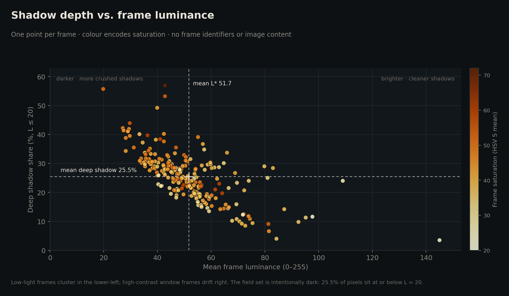
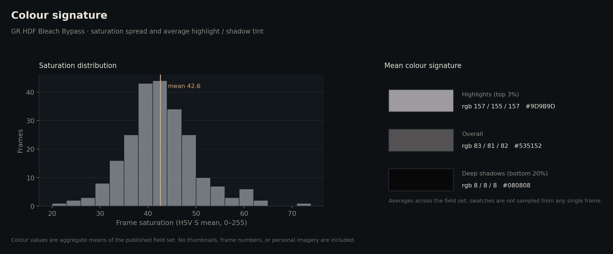

# Nikon NP3 Recipes

**English** | [简体中文](README.zh-CN.md)

A Nikon Z Flexible Color (NP3) recipe library inspired by Ricoh GR IV / GR IV HDF Image Controls, including Positive Film, Negative Film, and Bleach Bypass. Each recipe is a compact 392-byte NP3 file with import instructions, technical specifications, and reproducible color analysis.


Maintenance rules: [AGENTS.md](AGENTS.md) — every published NP3 ships with a companion CUBE; the repository name stays NP3-first.

> HDF glow is an optical diffusion effect produced by the lens/filter. It cannot be encoded in an NP3 file; these recipes only control in-camera color and tone.

## Recipes

| Recipe | Color direction | Character | NP3 | CUBE | Lightroom |
|---|---|---|---|---|---|
| [GR HDF Positive Film](gr-hdf-positive-film/) | Vivid positive-film color with controlled orange bias | High saturation, selective red/orange/yellow and blue boost, natural greens | [NP3](gr-hdf-positive-film/GRHDF_POSFILM.NP3) | [CUBE](gr-hdf-positive-film/GRHDF_POSFILM_sRGB.cube) | [XMP](gr-hdf-positive-film/GRHDF_POSFILM_Lightroom.xmp) |
| [GR HDF Negative Film](gr-hdf-negative-film/) | Natural skin and warm light, restrained greens and blues | Low saturation, cyan-green shadows, slightly lifted shadows | [NP3](gr-hdf-negative-film/GRHDF_NEGFILM.NP3) | [CUBE](gr-hdf-negative-film/GRHDF_NEGFILM_sRGB.cube) | [XMP](gr-hdf-negative-film/GRHDF_NEGFILM_Lightroom.xmp) |
| [GR HDF Bleach Bypass](gr-hdf-bleach/) | Low-saturation, high-contrast bleach bypass with cool metallic shadows | Field-calibrated low-light direction for bus / rainy available-light portraits | [NP3](gr-hdf-bleach/GRHDF_BLEACH.NP3) | [CUBE](gr-hdf-bleach/GRHDF_BLEACH_sRGB.cube) | [XMP](gr-hdf-bleach/GRHDF_BLEACH_Lightroom.xmp) |

Every published recipe ships with a 33³ sRGB `.cube` companion derived from the same NP3 parameter set. The CUBE carries the tone curve, Color Blender, and Color Grading only; it excludes sharpening, mid-range sharpening, clarity, and HDF glow. Use it on neutral sRGB / Rec.709 material in Resolve, Capture One, Affinity Photo, or Photoshop. Do not apply it again to a JPEG already shot with the same NP3.

Lightroom Classic cannot load `.cube` directly, so each recipe also ships a `_Lightroom.xmp` preset that maps the same parameters to Tone Curve, HSL, and Color Grading. The XMP is a third approximation, not a CUBE equivalent, and Lightroom's Sharpness floor of 0 cannot express the negative in-camera sharpening. Import it from the Presets panel with **Import Presets**.

### Parameter overview

| Recipe | Contrast | Highlights | Shadows | White / Black | Saturation | Softening (sharp / mid / clarity) |
|---|---:|---:|---:|---:|---:|---:|
| Positive Film | +7 | -8 | 0 | -6 / -1 | +24 | -1.5 / -2.5 / -3.0 |
| Negative Film | +4 | -8 | +1 | -5 / -1 | -4 | -1.5 / -2.5 / -3.0 |
| Bleach Bypass | +6 | -7 | -1 | -7 / -4 | -22 | -0.5 / -1.0 / -1.0 |

Detailed Color Blender and Color Grading values are in each recipe README.

The Positive / Negative recipes use light in-camera softening: sharpening **−1.5**, mid-range sharpening **−2.5**, clarity **−3.0**. Bleach Bypass uses a crisper **−0.5 / −1.0 / −1.0** because its low-light field direction needs more edge definition. None of these settings create HDF-style point-light glow.

Bleach Bypass is an independent field-calibrated direction. Its reference basis and 230-frame Z6III validation are documented in the [recipe README](gr-hdf-bleach/README.md); the eight-scene lab analysis remains scoped to the Positive / Negative Film series. It also ships an sRGB 3D LUT for post-processing: [GRHDF_BLEACH_sRGB.cube](gr-hdf-bleach/GRHDF_BLEACH_sRGB.cube). The LUT carries the tone / color / grading mapping; spatial softening and HDF remain outside the LUT.

## Quick import

1. Copy the `.NP3` file to the card root or to `NIKON/CUSTOMPC`.
2. Insert the card into the camera's primary card slot.
3. Open **Photo/Video Shooting Menu → Manage Picture Control → Load/Save → Copy from card to camera**.
4. Import to C-1 through C-9, then select the profile in **Set Picture Control**.

Nikon manuals explicitly document Flexible Color import on **Z6III, Z50II, Z5II, Zf, and Z8**. Check the manual for other models before importing. Imported profiles cannot be edited or renamed in-camera.

Official manuals: [Z6III](https://onlinemanual.nikonimglib.com/z6III/en/picture_controls_42.html) · [Z50II](https://onlinemanual.nikonimglib.com/z50II/en/18-07.html) · [Z5II](https://onlinemanual.nikonimglib.com/z5II/en/picture_controls_41.html) · [Zf](https://onlinemanual.nikonimglib.com/zf/en/adding_cloud_picture_control_364.html) · [Z8](https://onlinemanual.nikonimglib.com/z8/en/adding_flexible_color_to_picture_control_392.html)

## Color analysis

The analysis uses offline simulations of eight high-resolution scenes: fireworks, night traffic, wet neon, market produce, portrait, courtyard, backlit sunset, and garden. Full data is in [scene_metrics.csv](docs/data/scene_metrics.csv); method notes are in [methodology.md](docs/methodology.md).

### Lab palette footprint



### Hue frequency



### Saturation by scene



Across the eight scenes, the mean HSV saturation is **110.35** for the original, **132.75 (+20.3%)** for Positive Film, and **90.33 (−18.1%)** for Negative Film. The share of pixels with `S ≥ 160` is **23.55% / 42.00% / 14.36%**. These figures describe the simulation set only, not camera measurements or gamut coverage.

Bleach Bypass is a field-calibrated direction with its own reference set. Its validation is based on the 2026-11-08 Z6III field set described under [Validation](#validation); the eight-scene lab analysis above continues to document the Positive / Negative Film series.

## Field analysis — Bleach Bypass

A separate dataset: 230 in-camera JPEGs from a dark bus interior in rainy available light, all shot with `GRHDF_BLEACH.NP3`. Aggregate data only — no frame identifiers, thumbnails, or personal imagery are published. Full numbers are in [bleach_field_metrics.csv](docs/data/bleach_field_metrics.csv).

### Tone distribution



Luminance sits low and tight (mean **51.7**, median **49.9**), which is the intended dark baseline. Deep shadows average **25.5%** of the frame. Highlight clipping is concentrated at zero: median **0.0%**, p95 **3.1%**, with a short tail from deliberate window overexposure.

### Shadow depth vs. luminance



Each point is one frame. The cloud runs diagonally: low-light frames carry the most crushed shadow, while window-heavy frames move right and drop in shadow share. Saturation rises slightly toward the darker, cooler frames.

### Colour signature



Mean saturation is **42.6**, well below the Positive Film range. Highlight average sits near neutral grey; deep shadows sit near black with no colour cast. The cool metallic look comes from the grading separation, not from a global tint.

## Technical specification

| Item | Detail |
|---|---|
| File format | Nikon NCP / NP3 |
| File size | 392 bytes |
| Profile name | 19 bytes maximum |
| Parameter model | Nikon Picture Control relative values, not Ricoh's native parameters |
| Import method | Flexible Color, C-1 to C-9 |
| In-camera editing | Not supported |
| HDF glow | Not included in NP3; requires offline processing or a physical HDF filter |
| Post-processing LUT | Every recipe: `<NP3_STEM>_sRGB.cube`, 33³, sRGB → sRGB; tone / color / grading only, no spatial softening |
| Lightroom preset | Every recipe: `<NP3_STEM>_Lightroom.xmp`; Tone Curve, HSL, Color Grading; no negative sharpening, clarity softening, or HDF glow |
| Build template | A known-importable NX Studio export supplied by the user; binary structure informed by [nikon-flexible-color-picture-control](https://github.com/ssssota/nikon-flexible-color-picture-control) (MIT) |

## Design method

The Ricoh GR IV / GR IV HDF firmware record currently lists **1.11** (2026-02-13). Ricoh's GR IV product page states that the conventional Image Control options were retuned. The official FAQ describes **Negative Film** as "producing images resembling those taken on negative film" and **Positive Film** as "producing high-saturation images resembling positive film." Final calibration also referenced official GR IV HDF gallery images explicitly tagged Positive Film / Negative Film with HDF:ON.

- [GR IV / GR IV HDF firmware record](https://www.ricoh-imaging.co.jp/english/support/digital/gr4_s.html)
- [GR IV Image Control page](https://www.ricoh-imaging.co.jp/english/products/gr-4/feature/03.html)
- [GR IV Image Control FAQ](https://www.ricoh-imaging.co.jp/english/support/qa/gr-4/index.html)
- [GR IV HDF gallery](https://www.ricoh-imaging.co.jp/english/products/gr-4/special/hdf/)

Ricoh does not publish the internal curves or full parameter sets for these Image Controls. These Nikon recipes are therefore a visual approximation based on official definitions and sample images, not a parameter-level reproduction of Ricoh's processing engine.

Calibration principle: Positive Film and Negative Film preserve their inherent saturation relationship — high saturation and low-saturation soft contrast, respectively. Bleach Bypass is an independent low-light direction, calibrated against the Ricoh Bleach Bypass reference and cross-referenced with Fujifilm ETERNA Bleach Bypass, with its own Z6III field validation.

## Validation

- **2026-10-10**: Both profiles are 392-byte NCP / NP3 files. An independent parser read the names, adjustment fields, color blenders, and color grading. Byte comparison confirmed that only the name and recipe parameter regions differ from the template.
- **2026-11-06**: Field use on a Nikon Z6III with in-camera JPEG output — 190 frames with Negative Film and 10 frames with Positive Film, with no import or recognition issues. No personal samples are published in this repository.
- **2026-11-08**: Field use of Bleach Bypass on a Nikon Z6III — 230 in-camera JPEGs in a dark bus / rainy available-light setting, with no import or recognition issues. No personal samples are published. The field set averaged luma 51.7, deep shadows 25.5%, highlight clipping 0.6%, and HSV saturation 42.6.

Not covered: other camera models, video mode, or systematic testing across white balance and exposure combinations. For first use, verify the profile in **Manage Picture Control → Load/Save → Copy from card to camera**.

## Limitations

- The analysis charts describe offline simulations. They are not NX Studio output, camera JPEGs, or a per-parameter simulation of in-camera softening.
- HSV and Lab metrics describe relative changes in the simulation set; they are not colorimeter readings or gamut coverage measurements.
- HDF requires spatial diffusion and cannot be stored in NP3. Offline HDF demonstrations do not represent the physical strength of Ricoh's HDF filter.
- Camera JPEG engines, white balance, exposure, and lenses can produce visible differences.

## Repository layout

```text
.
├── docs/
│   ├── data/scene_metrics.csv
│   ├── data/bleach_field_metrics.csv
│   ├── images/                 # color analysis charts
│   ├── methodology.md
│   └── release-process.md
├── tools/
│   └── check_release.py        # release gate
├── gr-hdf-positive-film/
│   ├── GRHDF_POSFILM.NP3
│   ├── GRHDF_POSFILM_sRGB.cube
│   ├── GRHDF_POSFILM_Lightroom.xmp
│   └── README.md
├── gr-hdf-negative-film/
│   ├── GRHDF_NEGFILM.NP3
│   ├── GRHDF_NEGFILM_sRGB.cube
│   ├── GRHDF_NEGFILM_Lightroom.xmp
│   └── README.md
├── gr-hdf-bleach/
│   ├── GRHDF_BLEACH.NP3
│   ├── GRHDF_BLEACH_sRGB.cube
│   ├── GRHDF_BLEACH_Lightroom.xmp
│   └── README.md
├── AGENTS.md
├── CHANGELOG.md
├── README.zh-CN.md
└── THIRD_PARTY_LICENSES.txt
```

## Roadmap

- Keep the inherent color relationship of Positive / Negative Film aligned with official samples; adjust only when a deviation from the official direction is found.
- Add new film/color directions, one folder per recipe.
- Expand official compatibility verification across Nikon models.
- Add per-recipe bilingual technical notes.

## License and credits

Recipe files may be downloaded, used, modified, and redistributed with attribution. The analysis charts are derived from third-party photographs; sources, licenses, and modifications are documented in [THIRD_PARTY_LICENSES.txt](THIRD_PARTY_LICENSES.txt). This repository contains no personal portrait samples.

## Changelog

See [CHANGELOG.md](CHANGELOG.md).
