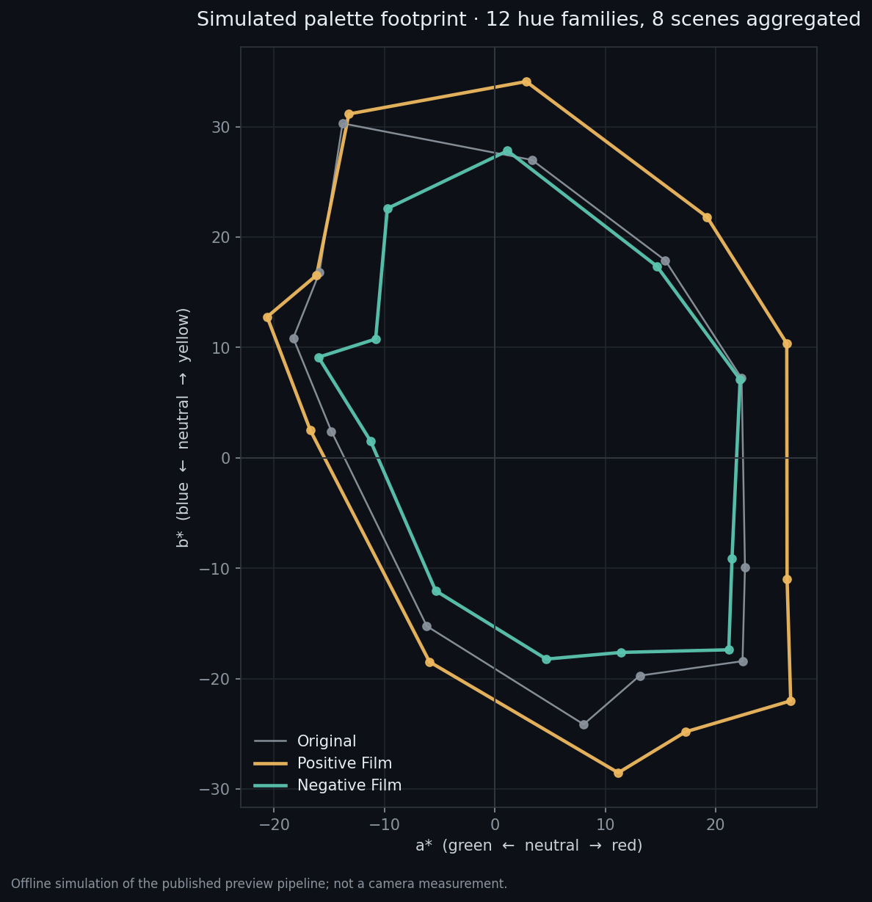
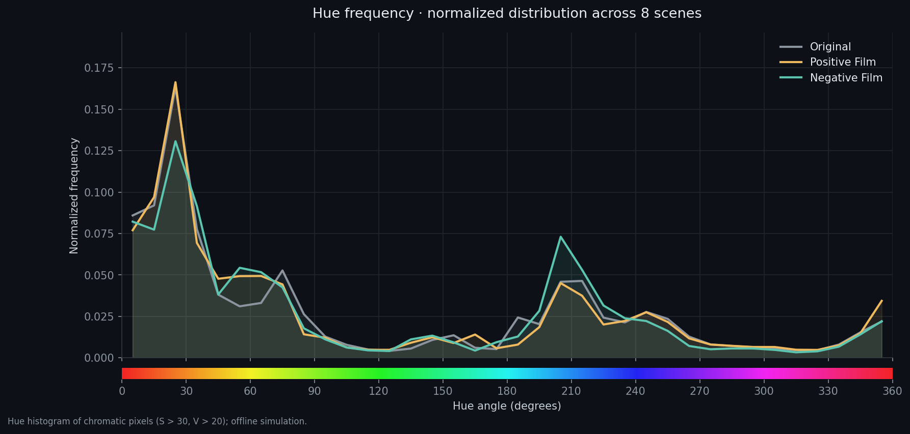
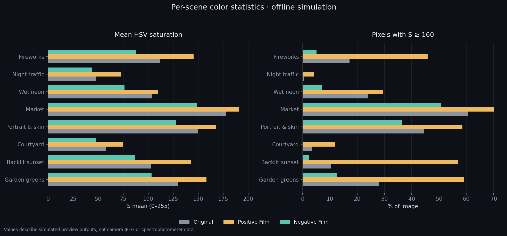

# Nikon NP3 Recipes

[English](README.md) | **简体中文**

**Nikon Z 系列 Flexible Color（NP3）配方库**，以 Ricoh GR IV / GR IV HDF 的官方资料与成片为参考，包含 Positive Film、Negative Film 与 Bleach Bypass 三个方向，提供可直接导入相机的机内 JPEG 配方、技术规格和完整的导入说明。


> 色彩分析基于离线模拟，不是相机 JPEG 或 NX Studio 输出。HDF 光晕是镜头/滤镜产生的空间扩散，不能写入 NP3；本库配方只负责机内色彩与影调。

## 配方

| 配方 | 色彩方向 | 关键词 | 文件 |
|---|---|---|---|
| [GR HDF Positive Film](gr-hdf-positive-film/) | 选择性鲜明的正片色彩，控制整体偏橙 | 高饱和、红橙黄与蓝色增强、自然绿植 | [GRHDF_POSFILM.NP3](gr-hdf-positive-film/GRHDF_POSFILM.NP3) |
| [GR HDF Negative Film](gr-hdf-negative-film/) | 自然肤色与暖光，收敛绿植与蓝色 | 低饱和、青绿阴影、轻微抬暗部 | [GRHDF_NEGFILM.NP3](gr-hdf-negative-film/GRHDF_NEGFILM.NP3) |
| [GR HDF Bleach Bypass](gr-hdf-bleach/) | 低饱和、高对比的漂白旁路 | 低照度现场光方向；冷调金属阴影、暗调车厢 / 雨天人像 | [GRHDF_BLEACH.NP3](gr-hdf-bleach/GRHDF_BLEACH.NP3) |

### 参数总览

| 配方 | Contrast | Highlights | Shadows | White / Black | Saturation | 柔化（锐化 / 中间调 / 清晰度） |
|---|---:|---:|---:|---:|---:|---:|
| Positive Film | +7 | -8 | 0 | -6 / -1 | +24 | -1.5 / -2.5 / -3.0 |
| Negative Film | +4 | -8 | +1 | -5 / -1 | -4 | -1.5 / -2.5 / -3.0 |
| Bleach Bypass | +6 | -7 | -1 | -7 / -4 | -22 | -0.5 / -1.0 / -1.0 |

完整 Color Blender 与 Color Grading 数值见每个配方的 README。

Positive / Negative 配方加入了轻度机内柔化：锐化 **−1.5**、中间调锐化 **−2.5**、清晰度 **−3.0**。Bleach Bypass 使用更脆的 **−0.5 / −1.0 / −1.0**，因为它的低照度现场方向需要更多边缘定义。这些设置都不会生成 HDF 式点光源光晕。

Bleach Bypass 是独立的现场校准方向，参考体系与 230 张 Z6III 验证记录见 [配方 README](gr-hdf-bleach/README.md)；8 场景实验室分析继续用于 Positive / Negative Film 系列。它还提供一个 sRGB 3D LUT 供后期使用：[GRHDF_BLEACH_sRGB.cube](gr-hdf-bleach/GRHDF_BLEACH_sRGB.cube)。LUT 承载色彩 / 影调 / 分级映射；空间柔化与 HDF 不在 LUT 内。

## 快速导入

1. 将 `.NP3` 文件复制到存储卡根目录，或放在 `NIKON/CUSTOMPC` 文件夹。
2. 把卡插入相机的主卡槽。
3. 打开 **照片/视频拍摄菜单 → 管理 Picture Control → 载入/保存 → 从卡复制到相机**。
4. 导入到 C-1 至 C-9 后，在 **设定 Picture Control** 里选择对应配置。

Nikon 手册已明确记载支持 Flexible Color 导入的机型：**Z6III、Z50II、Z5II、Zf、Z8**。其他机型请先查对应手册是否支持 NP3 / Flexible Color。导入后不能在机身上编辑或重命名，这是 Nikon 的固有限制。

官方操作手册： [Z6III](https://onlinemanual.nikonimglib.com/z6III/en/picture_controls_42.html) · [Z50II](https://onlinemanual.nikonimglib.com/z50II/en/18-07.html) · [Z5II](https://onlinemanual.nikonimglib.com/z5II/en/picture_controls_41.html) · [Zf](https://onlinemanual.nikonimglib.com/zf/en/adding_cloud_picture_control_364.html) · [Z8](https://onlinemanual.nikonimglib.com/z8/en/adding_flexible_color_to_picture_control_392.html)

## 色彩分析

分析使用 8 个高分辨率场景的离线模拟输出，覆盖烟花、夜间车流、雨后霓虹、菜市场、人像、庭院、逆光日落和花园。完整数据见 [scene_metrics.csv](docs/data/scene_metrics.csv)，方法说明见 [methodology.md](docs/methodology.md)。

### Lab 色度分布



### 色相频率



### 逐场景饱和度



8 个场景等权平均后，HSV 饱和度均值为：原图 **110.35**、Positive Film **132.75（+20.3%）**、Negative Film **90.33（−18.1%）**；`S≥160` 像素占比为 **23.55% / 42.00% / 14.36%**。这些只说明同一批照片的模拟变化，不代表相机实测或色域覆盖。

Bleach Bypass 是现场校准方向，拥有独立的参考体系与验证集；其验证基于 [验证记录](#验证记录) 中 2026-11-08 的 Z6III 实拍，8 场景实验室分析继续记录 Positive / Negative Film 系列。

## 技术规格

| 项目 | 说明 |
|---|---|
| 文件格式 | Nikon NCP / NP3 |
| 文件大小 | 392 bytes |
| 配方名称 | 最多 19 bytes |
| 参数体系 | Nikon Picture Control 相对值，不是 Ricoh 原始参数 |
| 导入方式 | Flexible Color，C-1 至 C-9 |
| 机内编辑 | 不支持编辑或重命名 |
| HDF 光晕 | 不包含在 NP3 内，需离线处理或实体 HDF 滤镜 |
| 后期 LUT | 仅 Bleach Bypass：`GRHDF_BLEACH_sRGB.cube`，33³，sRGB → sRGB；仅色彩 / 影调 / 分级，不含空间柔化 |
| 构建模板 | 用户提供的、已知可导入 NX Studio 导出文件；二进制结构参考 [nikon-flexible-color-picture-control](https://github.com/ssssota/nikon-flexible-color-picture-control)（MIT） |

## 设计方法

理光官方 GR IV 固件页当前列出 GR IV / GR IV HDF **1.11**（2026-02-13）。GR IV 产品页说明传统 Image Control 已重新调校；官方 FAQ 将 Positive Film 描述为高饱和正片风格，将 Negative Film 描述为模拟负片成像。最终校准还参考了官方 GR IV HDF 画廊中实际标记 Positive Film / Negative Film、HDF:ON 的成片。

- [GR IV / GR IV HDF 官方固件记录](https://www.ricoh-imaging.co.jp/english/support/digital/gr4_s.html)
- [GR IV 官方 Image Control 说明](https://www.ricoh-imaging.co.jp/english/products/gr-4/feature/03.html)
- [GR IV 官方 Image Control FAQ](https://www.ricoh-imaging.co.jp/english/support/qa/gr-4/index.html)
- [GR IV HDF 官方成片画廊](https://www.ricoh-imaging.co.jp/english/products/gr-4/special/hdf/)

理光没有公开这两种 Image Control 的内部曲线和逐项参数，因此 Nikon 配方只能按官方定义和成片进行视觉近似，不能称为逐参数复制，也不是理光算法本身。不同相机的 JPEG 引擎、白平衡与曝光会造成差异。

校准原则：以官方定义和官方成片为基准，Positive Film 与 Negative Film 保持各自的固有饱和度关系——高饱和与低饱和柔和反差。Bleach Bypass 是独立的低照度方向，主参考理光 Bleach Bypass，交叉参考富士 ETERNA Bleach Bypass，并有自己的 Z6III 现场验证。

## 验证记录

- **2026-10-10**：两份输出均为 392 字节 NCP / NP3；用独立 NP3 解析器读取后，名称、调节项、色彩混合器和色彩分级均可解析。逐字节比对确认只有名称和配方参数区发生变化。
- **2026-11-06**：在 Nikon Z6III 上完成机内 JPEG 直出使用，Negative Film 方向 190 张、Positive Film 方向 10 张，未发现导入或识别问题。个人样片不进入本仓库。
- **2026-11-08**：在 Nikon Z6III 上完成 Bleach Bypass 机内 JPEG 实拍 230 张，场景为暗调公交车厢 / 雨天现场光，未发现导入或识别问题。个人样片不公开。整组平均亮度 51.7、深暗部 25.5%、高光裁剪 0.6%、HSV 饱和度 42.6。

未覆盖：其他机型、视频模式、不同白平衡与曝光组合下的系统测试；首次使用仍建议在“管理 Picture Control → 载入/保存 → 从卡复制到相机”核对列表。

## 准确性边界

- 分析图表基于可重复的离线模拟，不是 NX Studio 或相机实拍，也不模拟机内柔化参数的逐项效果。
- HSV 与 Lab 指标只描述模拟输出的变化，不替代色度计、色域覆盖率或实机测量。
- HDF 需要空间扩散，不能写进 NP3；离线演示不代表理光实体滤镜的物理强度。
- 不同相机的 JPEG 引擎、白平衡、曝光和镜头会造成明显差异。

## 仓库结构

```text
.
├── docs/
│   ├── data/scene_metrics.csv
│   ├── images/                 # 色彩分析图表
│   └── methodology.md
├── gr-hdf-positive-film/
│   ├── GRHDF_POSFILM.NP3
│   └── README.md
├── gr-hdf-negative-film/
│   ├── GRHDF_NEGFILM.NP3
│   └── README.md
├── gr-hdf-bleach/
│   ├── GRHDF_BLEACH.NP3
│   ├── GRHDF_BLEACH_sRGB.cube
│   └── README.md
├── CHANGELOG.md
├── README.md                   # English
├── README.zh-CN.md
└── THIRD_PARTY_LICENSES.txt
```

## Roadmap

- 按官方样片持续核对 Positive / Negative Film 的固有色彩关系；只在发现与官方方向偏离时微调。
- 增加新的胶片/色彩方向配方，保持每个配方独立文件夹。
- 扩展更多 Nikon 机型的官方兼容性核对。
- 补充逐配方双语技术说明。

## 许可与署名

配方文件可自由下载、使用和修改；再分发时注明来源即可。`docs/images/` 中的分析图表由第三方照片的模拟输出生成，来源、许可和改动说明见 [THIRD_PARTY_LICENSES.txt](THIRD_PARTY_LICENSES.txt)，再分发时请保留署名、来源和许可信息。本仓库不包含个人肖像样片。

## 更新记录

见 [CHANGELOG.md](CHANGELOG.md)。
