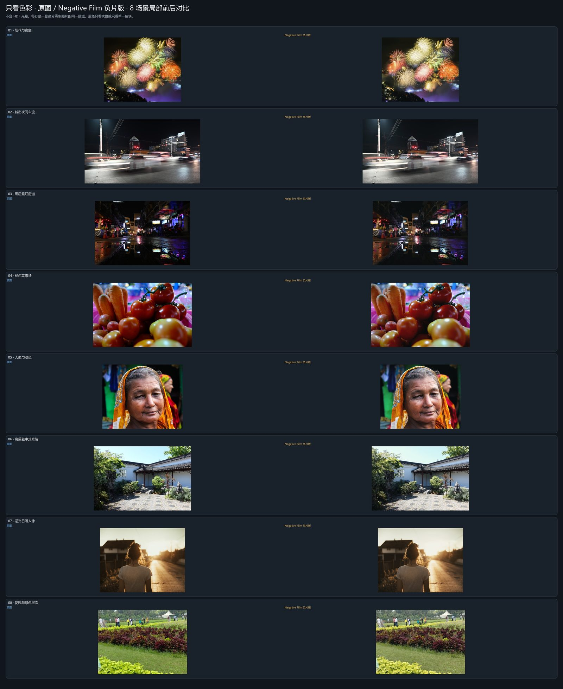
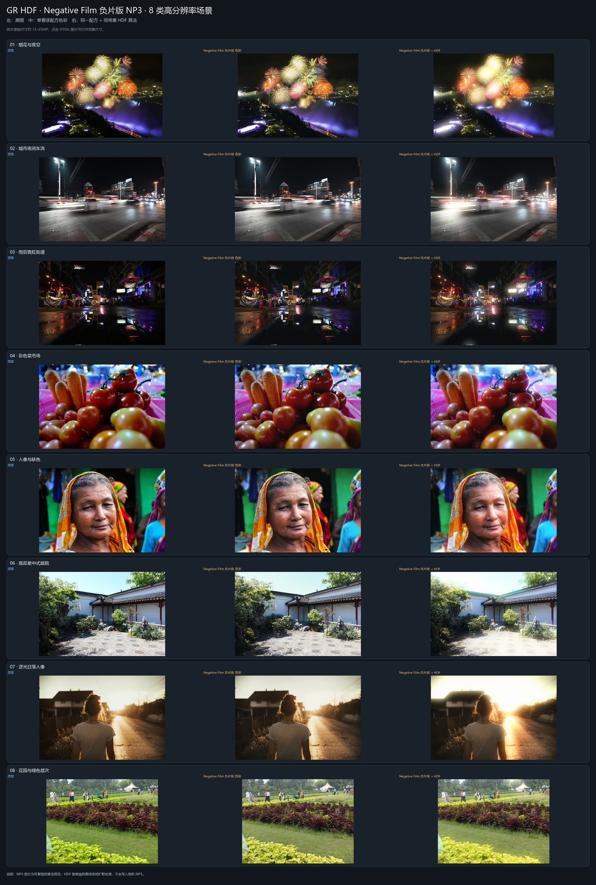
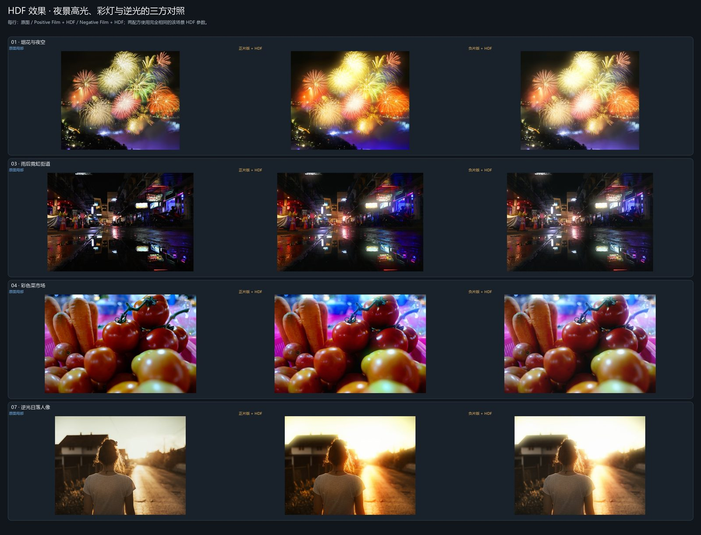

# GR HDF Negative Film

[`GRHDF_NEGFILM.NP3`](GRHDF_NEGFILM.NP3) · 392 字节 NCP / NP3 · Nikon Flexible Color

负片方向：保留肤色和暖光，收敛绿植与蓝色，轻微抬暗部并加少量青绿色阴影。附带与正片版相同的轻度机内柔化。

**状态**：2026-11-06 在 Nikon Z6III 上完成 190 张机内 JPEG 实拍，未发现导入或识别问题；个人样片不公开。完整方法见仓库 [methodology.md](../docs/methodology.md)。

## 预览

## 参数摘要

| Picture Control 项 | 值 |
|---|---:|
| Contrast / Highlights / Shadows | +4 / -8 / +1 |
| White Level / Black Level | -5 / -1 |
| Sharpening / Mid-range sharpening | -1.5 / -2.5 |
| Saturation / Clarity | -4 / -3.00 |
| 色彩混合重点 | 橙 +3；黄 -8、绿 -18、蓝 -8 |
| 影调分级重点 | 高光暖中性、阴影少量青绿 |

以上为 Nikon 相对值，不是理光的原始参数。

## 导入

1. `.NP3` 复制到存储卡根目录或 `NIKON/CUSTOMPC`。
2. 插卡，进入 **管理 Picture Control → 载入/保存 → 从卡复制到相机**。
3. 导入到 C-1 至 C-9，在 **设定 Picture Control** 中选择。

支持机型：Z6III、Z50II、Z5II、Zf、Z8（以 Nikon 手册为准）。导入后不能在机身编辑或重命名。

## 说明

按理光 GR IV 官方 Negative Film 定义与官方成片做的视觉近似，不是逐参数复制。HDF 光晕不在 NP3 内，预览中的光晕为离线算法对照。全部预览的第三方照片来源与许可见仓库根目录 [THIRD_PARTY_LICENSES.txt](../THIRD_PARTY_LICENSES.txt)。
